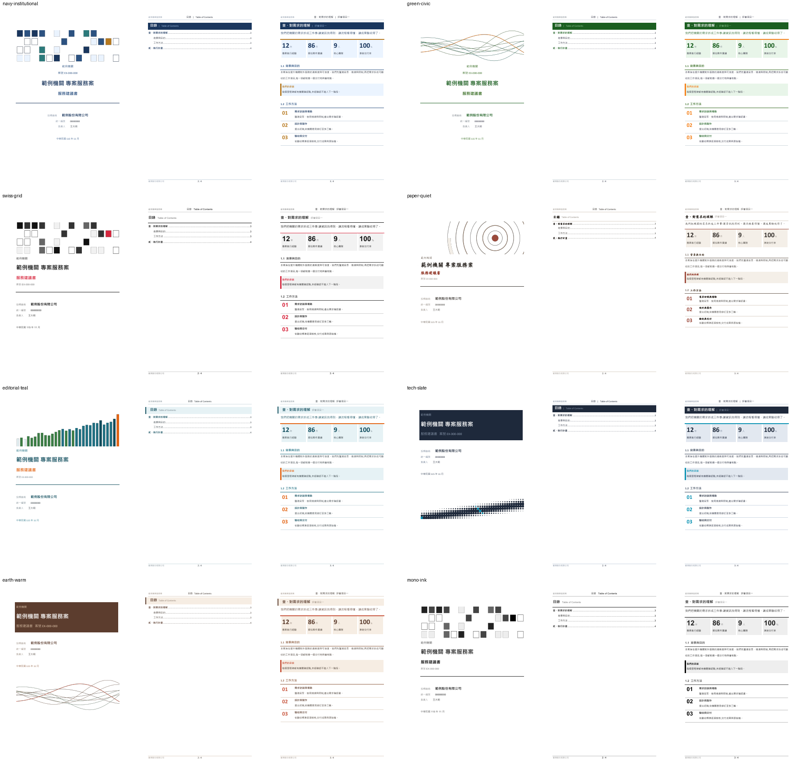
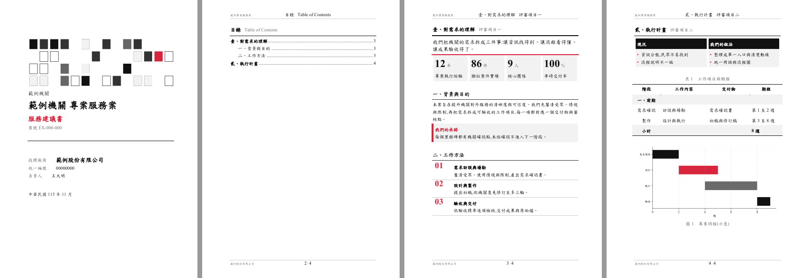

# tw-tender-bid

台灣政府標案投標文件生成 skill(適用 Claude Code 等支援 `SKILL.md` 的 AI agent)。

給它一包招標資料(投標須知、評審須知、需求說明書、契約、標價清單),它會依固定流程完成:拆標、抽出**格式規格**(字體、字級、行距、紙張、標號)、做評審項目響應矩陣、挑選視覺風格、撰寫服務建議書或企劃書、備齊附件,並在交件前核對格式規格、廢標風險與前後一致性,輸出 Word 與 PDF。

設計重點:**規格依招標文件,風格才可自由變化。** 台灣標案常規定標楷體、字級、固定行高、標號格式、頁數上限,這些逐案不同,所以抽成 `format.json` 並有審查腳本核對;配色、標題樣式、封面版式則做成可替換的風格包,每案可以不同。

## 風格預覽

8 種風格包(封面圖由色票自動生成,隨案名變化):



照招標文件規格產出的範例(標題 16 點、內文 14 點、標楷體、固定行高 22 點、標號壹、一、(一)):



## 內容

```
tw-tender-bid/
  SKILL.md                      流程、鐵則、關卡
  assets/
    company_profile.template.json   空白公司 profile 模板
    format.template.json            招標格式規格模板
    spec_example.json               產生文件的 spec 範例
    styles/*.json                   8 個風格包
  references/                   法規重點(已查證)、拆標模板、規格與風格說明、配分整理、
                                章節藍圖、應繳文件與審查清單、外部 skill 整理
  scripts/
    extract_rfp.py              招標文件轉文字(docx、doc、odt、ods、pdf、xlsx)
    build_proposal.py           spec JSON 轉 Word(目錄、標題樣式、表格、圖表、元件、自動標號)
    bid_kit.py / bid_components.py   版面底層與元件(重點數字卡、提示框、步驟、雙欄、章節扉頁、封面圖)
    preview_styles.py           同一份內容套多個風格並輸出預覽
    make_style.py               用色碼或 ui-ux-pro-max 配色資料產生新風格包
    audit_bid.py                交件前自動審查(格式規格、價格、盲評、殘留待補、簡體字等)
    profile_loader.py           載入公司 profile
```

## 安裝

1. 把 `tw-tender-bid/` 整個資料夾複製到 skills 目錄,例如 Claude Code 的 `~/.claude/skills/`。
2. 安裝相依套件:`pip install -r requirements.txt`(Python 3.10 以上)。
3. 選用:Windows 加 Microsoft Word,可讀 `.doc`、輸出 PDF 預覽、用 `--finalize` 更新欄位;預覽圖需要 poppler 的 `pdftoppm`。

## 設定公司資料

skill 本體不含任何公司資料。複製 `assets/company_profile.template.json`,填入公司全稱、統編、負責人等,存成 `~/.claude/tender-profiles/default.json`,或用環境變數 `TW_TENDER_PROFILE` 指向它。簽章圖檔只填路徑,不要放進 repo。

沒有設定 profile 時,文件會出現【待補】,審查腳本會抓出來。

## 使用

在 agent 中貼上招標資料並說「幫我投這個標案」,skill 會依 `SKILL.md` 的六個階段進行,四個關卡會停下來等你確認(拆標、策略與風格、審查、送出前)。單獨使用腳本:

```
python -I scripts/extract_rfp.py <招標資料夾> --out 01_拆標/text
python -I scripts/preview_styles.py --out 03_草稿/style_preview --format 01_拆標/format.json --pdf
python -I scripts/build_proposal.py spec.json --out 成品.docx --finalize
python -I scripts/audit_bid.py 成品.docx --format 01_拆標/format.json --pdf 成品.pdf --price <總價>
```

## 限制與聲明

- 以台灣政府採購為前提,不處理中國大陸招投標。
- 不提供法律意見。`references/tw-procurement-basics.md` 的法條重點附查證日期與來源,實際案件以招標文件載明的版本為準。
- 不自動投遞、不自動蓋章簽名、不決定報價。這些都需要使用者確認。
- 格式核對驗證 docx 本身的字體、字級、行距、邊界等;PDF 字型嵌入與不同電腦的字型替換需人工確認。
- `references/scoring-patterns.md` 的配分整理來自實際標案,已去識別化。
- `references/external-skills-notes.md` 整理了 GitHub 上其他標書類 skill 的取捨;本專案的文字與程式碼為自行撰寫,未複製他人原文。

## 授權

MIT
