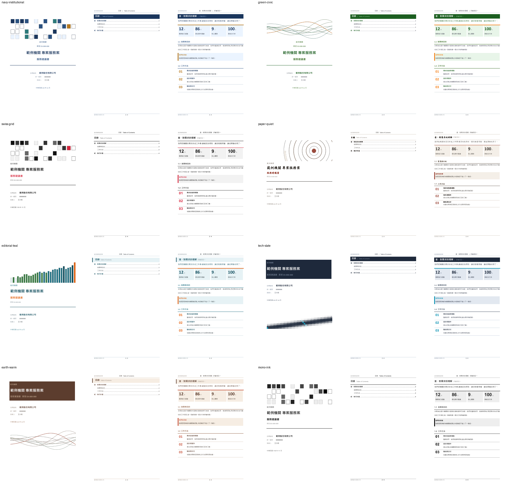
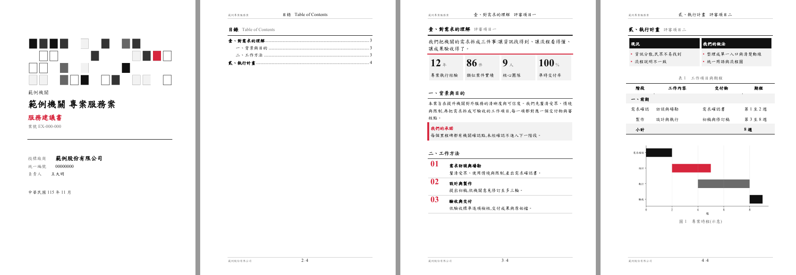

# tw-tender-bid

台灣政府標案投標文件生成 skill(適用 Claude Code 等支援 `SKILL.md` 的 AI agent)。

給它一包招標資料(投標須知、評審須知、需求說明書、契約、標價清單),它會依固定流程完成:拆標、抽出**格式規格**(字體、字級、行距、紙張、標號)、做評審項目響應矩陣、挑選視覺風格、撰寫服務建議書或企劃書、備齊附件,並在交件前核對格式規格、廢標風險與前後一致性,輸出 Word 與 PDF。

設計重點:**規格依招標文件,風格才可自由變化。** 台灣標案常規定標楷體、字級、固定行高、標號格式、頁數上限,這些逐案不同,所以抽成 `format.json` 並有審查腳本核對;配色、標題樣式、封面版式則做成可替換的風格包,每案可以不同。

## 風格預覽

8 種風格包(封面圖由色票自動生成,隨案名變化):



照招標文件規格產出的範例(標題 16 點、內文 14 點、標楷體、固定行高 22 點、標號壹、一、(一)):



## 快速開始

1. 把 `tw-tender-bid/` 整個資料夾複製到 skills 目錄,例如 Claude Code 的 `~/.claude/skills/`。
2. `pip install -r requirements.txt`(Python 3.10 以上)。
3. 設定公司資料:複製 `tw-tender-bid/assets/company_profile.template.json`,填寫後存成 `~/.claude/tender-profiles/default.json`(或用環境變數 `TW_TENDER_PROFILE` 指向它)。skill 本體不含任何公司資料,簽章圖檔只填路徑,不要放進 repo。
4. 先跑示範確認環境(Windows 且有 Word):`powershell -ExecutionPolicy Bypass -File examples/demo/run_demo.ps1`,它用虛構資料產生三份文件、轉 PDF、合併成單一 PDF 與 Word、再做審查。
5. 在 agent 中貼上招標資料並說「幫我投這個標案」,依 `SKILL.md` 的六個階段進行,四個關卡會停下來等你確認。

完整的指令步驟見 [`tw-tender-bid/references/howto-run.md`](tw-tender-bid/references/howto-run.md)。

## 內容

```
tw-tender-bid/
  SKILL.md                      流程、鐵則、關卡
  assets/
    company_profile.template.json   空白公司 profile 模板
    format.template.json            招標格式規格模板
    submission.manifest.example.json 合併清單範例
    spec_example.json               產生文件的 spec 範例
    styles/*.json                   8 個風格包
  references/                   執行方式、法規重點(已查證)、拆標模板、規格與風格說明、
                                配分整理、章節藍圖、應繳文件與審查清單、外部 skill 整理
  scripts/
    extract_rfp.py              招標文件轉文字(docx、doc、odt、ods、pdf、xlsx)
    build_proposal.py           spec JSON 轉 Word(目錄、標題樣式、表格、圖表、元件、自動標號)
    bid_kit.py / bid_components.py   版面底層與元件(重點數字卡、提示框、步驟、雙欄、章節扉頁、封面圖)
    preview_styles.py           同一份內容套多個風格並輸出預覽
    make_style.py               用色碼或 ui-ux-pro-max 配色資料產生新風格包
    audit_bid.py                交件前自動審查(格式規格、價格、盲評、殘留待補、簡體字等)
    profile_loader.py           載入公司 profile
    tools/
      price_utils.py            含稅換算與中文大寫金額
      prep_seal.py              簽名與印章去背、裁切
      to_pdf.ps1                資料夾內 docx 轉 PDF(先更新欄位)
      merge_pdf.py              依清單合併 PDF 並建立書籤
      merge_docx.ps1            依清單合併成單一可編輯 Word,連續頁碼
examples/demo/                  虛構案件的一鍵示範
```

## 常用指令

```
python -I scripts/extract_rfp.py <招標資料夾> --out 01_拆標/text
python -I scripts/preview_styles.py --out 03_草稿/style_preview --format 01_拆標/format.json --pdf
python -I scripts/build_proposal.py spec.json --out 成品.docx --finalize
python -I scripts/audit_bid.py 成品.docx --format 01_拆標/format.json --pdf 成品.pdf --price <總價>
python -I scripts/tools/price_utils.py 1012000 --tax 0.05
python -I scripts/tools/merge_pdf.py manifest.json
```

## 限制與聲明

- 以台灣政府採購為前提,不處理中國大陸招投標。
- 不提供法律意見。`references/tw-procurement-basics.md` 的法條重點附查證日期與來源,實際案件以招標文件載明的版本為準。
- 不自動投遞、不自動蓋章簽名、不決定報價。這些都需要使用者確認。
- 格式核對驗證 docx 本身的字體、字級、行距、邊界等;PDF 字型嵌入與不同電腦的字型替換需人工確認。
- Word 相關功能(讀 `.doc`、轉 PDF、更新欄位、合併 Word)需要 Windows 與 Microsoft Word;其餘功能在任何平台可用。
- `references/scoring-patterns.md` 的配分整理來自實際標案,已去識別化。
- `references/external-skills-notes.md` 整理了 GitHub 上其他標書類 skill 的取捨;本專案的文字與程式碼為自行撰寫,未複製他人原文。
- 簽名與印章圖檔是敏感資料,請勿放進公開 repo 或共用雲端。

## 授權

MIT
